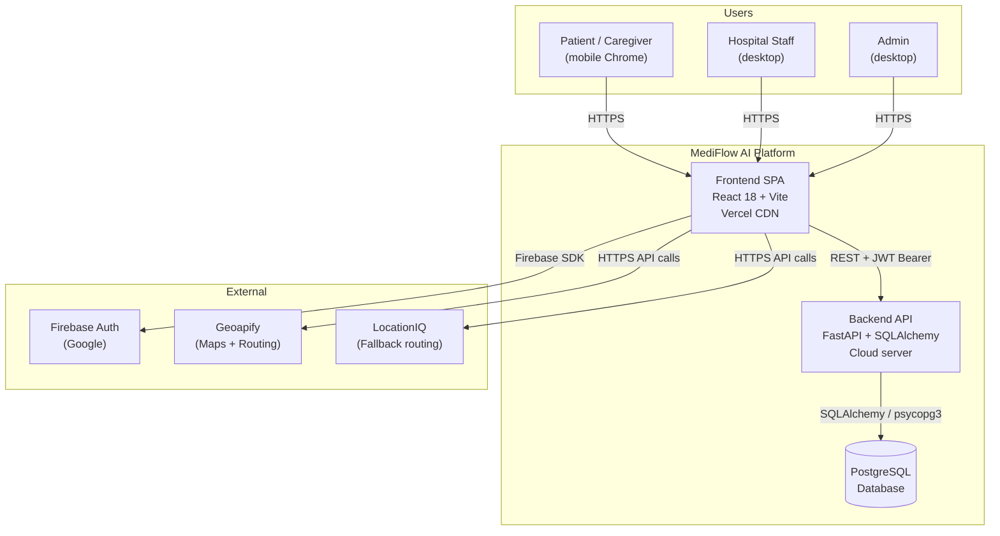
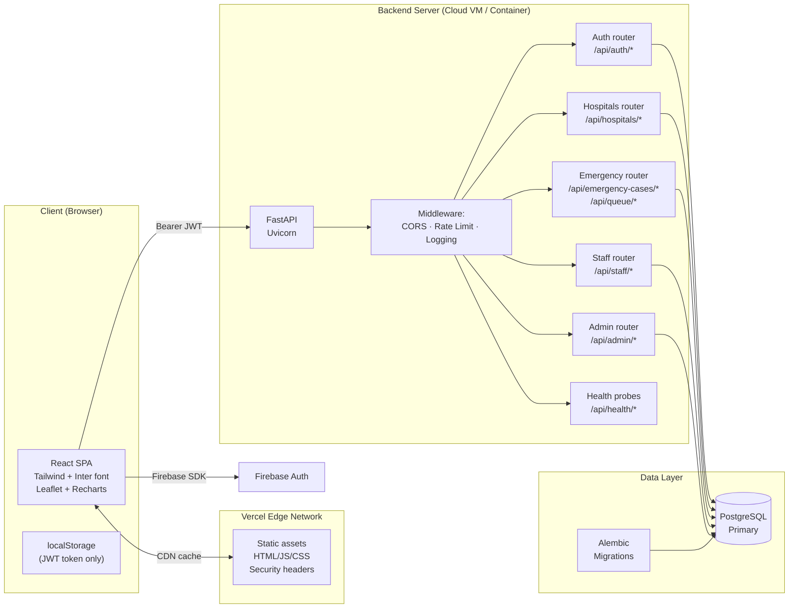
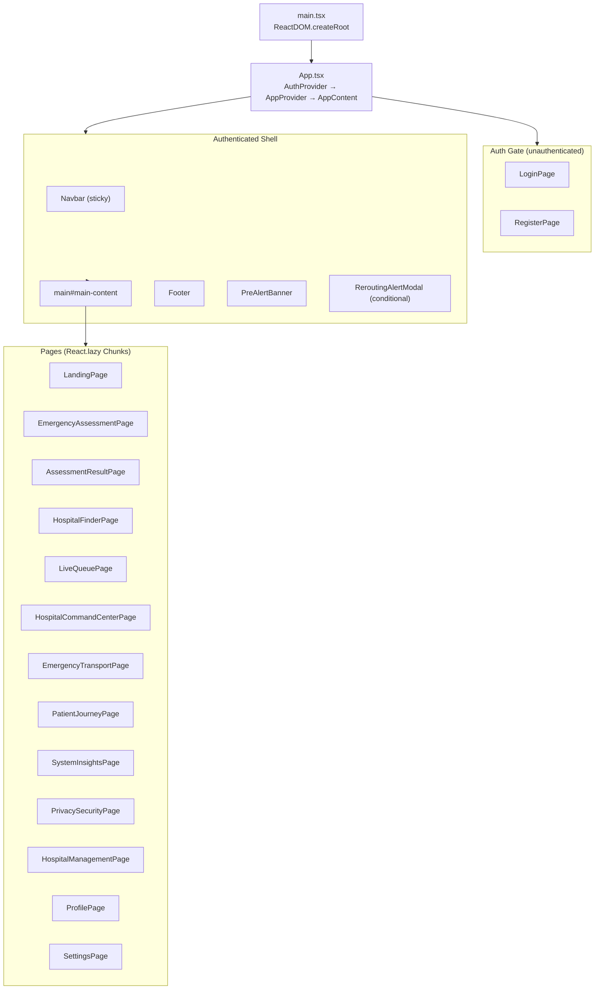
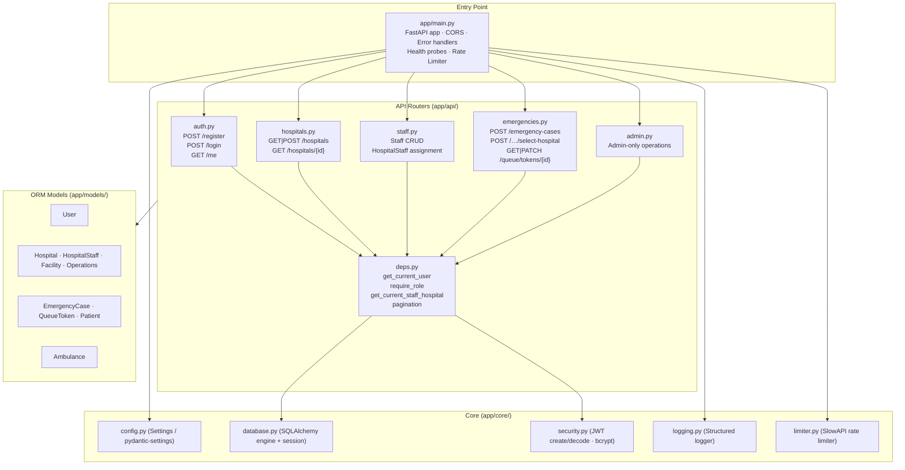

# MediFlow AI — Phase 2: System Architecture

> **Status:** APPROVED (Gate 1). Implementation Complete.
> **Date:** 2026-10-22
> **Architect:** Antigravity Engineering Team
> **Source:** Phase 0 Audit + confirmed design decisions

---

## A. System Context Diagram

---

## B. High-Level Architecture

---

## C. Frontend Component / Routing Architecture

---

## D. Backend Module / API Architecture

